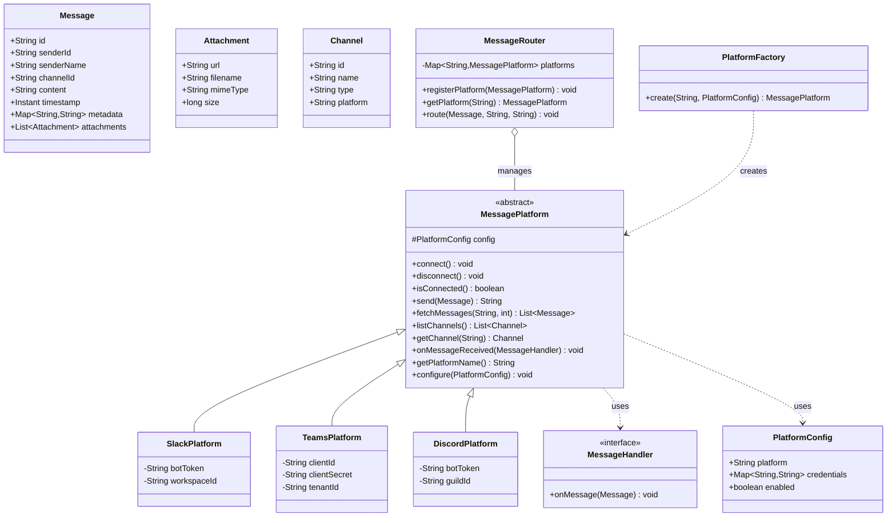

# Message Platform — Design Document

## Overview

`message-platform` is a lightweight Java library that acts as a **unified intermediate layer** between a client application and multiple messaging systems (Slack, MS Teams, Discord, etc.). It abstracts platform-specific APIs behind a single, consistent interface so that the client only interacts with one set of classes regardless of the underlying platform.

### Design Principles

- **Lightweight** — No heavy frameworks (no Spring, no Quarkus). Plain Java 17 + minimal dependencies.
- **Extensible** — Adding a new platform requires only one new class extending `MessagePlatform`.
- **Synchronous-first** — Simple blocking API by default; async can be layered on top later.
- **Stateless core** — The core model classes (`Message`, `Channel`) are plain data objects.

---

## Package Structure

```
com.messageplatform
├── core/                  # Core abstractions & models
│   ├── Message.java
│   ├── Attachment.java
│   ├── Channel.java
│   ├── MessagePlatform.java       (abstract parent class)
│   ├── MessageHandler.java        (callback interface)
│   └── PlatformConfig.java
├── platforms/             # Concrete platform adapters
│   ├── slack/
│   │   └── SlackPlatform.java
│   ├── teams/
│   │   └── TeamsPlatform.java
│   └── discord/
│       └── DiscordPlatform.java
└── service/               # Orchestration / routing
    ├── MessageRouter.java
    └── PlatformFactory.java
```

---

## Class Diagram



---

## Core Classes — Detailed Design

### 1. `Message` (core)

The unified message model. All platforms map their native message format to/from this.

| Field | Type | Description |
|-------|------|-------------|
| `id` | `String` | Platform-specific message ID (set after send) |
| `senderId` | `String` | Unique user/bot identifier on the platform |
| `senderName` | `String` | Display name of the sender |
| `channelId` | `String` | Target channel/conversation ID |
| `content` | `String` | Plain-text or rich-text body |
| `timestamp` | `Instant` | When the message was created/sent |
| `metadata` | `Map<String, String>` | Platform-specific extra fields (e.g. thread ID, reaction count) |
| `attachments` | `List<Attachment>` | Optional file/image attachments |

**Methods:**
- `static Message of(String channelId, String content)` — quick factory
- `withSender(String id, String name)` — fluent setter
- `withMetadata(String key, String value)` — fluent setter
- `addAttachment(Attachment att)` — fluent setter

---

### 2. `Attachment` (core)

| Field | Type | Description |
|-------|------|-------------|
| `url` | `String` | URL or local path to the file |
| `filename` | `String` | Display filename |
| `mimeType` | `String` | MIME type (e.g. `image/png`) |
| `size` | `long` | Size in bytes |

---

### 3. `Channel` (core)

| Field | Type | Description |
|-------|------|-------------|
| `id` | `String` | Platform-specific channel ID |
| `name` | `String` | Human-readable name |
| `type` | `String` | `direct`, `group`, `channel`, `thread` |
| `platform` | `String` | Which platform this channel belongs to |

---

### 4. `MessagePlatform` (core) — **Abstract Parent Class**

This is the key abstraction. Every platform adapter extends this class.

```java
public abstract class MessagePlatform {

    protected PlatformConfig config;

    // ─── Lifecycle ───────────────────────────────────────────────
    /** Establish connection / authenticate with the platform. */
    public abstract void connect() throws PlatformException;

    /** Gracefully close the connection and release resources. */
    public abstract void disconnect();

    /** Returns true if the platform is currently connected. */
    public abstract boolean isConnected();

    // ─── Sending ─────────────────────────────────────────────────
    /**
     * Send a message to the specified channel.
     * @param message the unified message (channelId must be set)
     * @return the platform-specific message ID
     */
    public abstract String send(Message message) throws PlatformException;

    // ─── Receiving / Fetching ────────────────────────────────────
    /**
     * Fetch the last N messages from a channel.
     * @param channelId target channel
     * @param limit     max number of messages to return
     */
    public abstract List<Message> fetchMessages(String channelId, int limit)
            throws PlatformException;

    // ─── Channel Management ──────────────────────────────────────
    /** List all channels the bot/user has access to. */
    public abstract List<Channel> listChannels() throws PlatformException;

    /** Get details for a specific channel. */
    public abstract Channel getChannel(String channelId) throws PlatformException;

    // ─── Event Handling ──────────────────────────────────────────
    /**
     * Register a callback to be invoked when a new message is received.
     * Implementations may use webhooks, polling, or WebSocket.
     */
    public abstract void onMessageReceived(MessageHandler handler);

    // ─── Configuration ───────────────────────────────────────────
    /** Set or update the platform configuration. */
    public void configure(PlatformConfig config) {
        this.config = config;
    }

    /** Returns the platform identifier (e.g. "slack", "teams", "discord"). */
    public abstract String getPlatformName();
}
```

**Design notes:**
- `connect()` / `disconnect()` allow the platform to manage its own connection lifecycle (HTTP session, WebSocket, OAuth token refresh, etc.).
- `send()` returns the platform-specific ID so the caller can reference it later (e.g. for editing or reacting).
- `onMessageReceived()` is the hook for push-based delivery. Platforms that only support polling can implement a background thread that calls the handler.
- All methods that can fail throw a checked `PlatformException` (see below).

---

### 5. `MessageHandler` (core) — Interface

```java
@FunctionalInterface
public interface MessageHandler {
    void onMessage(Message message);
}
```

A simple callback. The client registers one (or more) handlers per platform instance.

---

### 6. `PlatformConfig` (core)

| Field | Type | Description |
|-------|------|-------------|
| `platform` | `String` | Platform name (`slack`, `teams`, `discord`) |
| `credentials` | `Map<String, String>` | Key-value pairs (token, client-id, etc.) |
| `enabled` | `boolean` | Whether this platform is active |

---

### 7. `PlatformException` (core)

```java
public class PlatformException extends Exception {
    private final String platform;
    private final String code;   // platform-specific error code

    public PlatformException(String platform, String code, String message) { ... }
    public PlatformException(String platform, String code, String message, Throwable cause) { ... }
}
```

A single checked exception type for all platform errors. Carries the platform name and an optional platform-specific error code.

---

## Platform Adapters

Each adapter extends `MessagePlatform` and handles the platform-specific HTTP/WebSocket calls.

### `SlackPlatform`
- Uses Slack Web API (chat.postMessage, conversations.history, etc.)
- Credentials: `bot_token`, `workspace_id`
- Push: Slack Events API via webhook or Socket Mode

### `TeamsPlatform`
- Uses Microsoft Graph API / Bot Framework
- Credentials: `client_id`, `client_secret`, `tenant_id`
- Push: Bot Framework webhook

### `DiscordPlatform`
- Uses Discord REST API + Gateway (WebSocket)
- Credentials: `bot_token`, `guild_id`
- Push: Discord Gateway WebSocket

---

## Service Layer

### `MessageRouter`

Holds a registry of all connected `MessagePlatform` instances and provides a unified way to send messages "to a platform + channel" without the caller needing to know which concrete class to use.

```java
public class MessageRouter {

    private final Map<String, MessagePlatform> platforms = new ConcurrentHashMap<>();

    public void registerPlatform(MessagePlatform platform) { ... }
    public MessagePlatform getPlatform(String name) { ... }
    public void route(Message message, String targetPlatform, String targetChannel) { ... }
}
```

### `PlatformFactory`

Creates the correct `MessagePlatform` subclass based on a string name.

```java
public class PlatformFactory {

    public MessagePlatform create(String platformName, PlatformConfig config) {
        return switch (platformName.toLowerCase()) {
            case "slack"   -> new SlackPlatform(config);
            case "teams"   -> new TeamsPlatform(config);
            case "discord" -> new DiscordPlatform(config);
            default -> throw new IllegalArgumentException("Unknown platform: " + platformName);
        };
    }
}
```

---

## Usage Example (pseudo-code)

```java
// 1. Create and configure platforms
PlatformConfig slackConfig = new PlatformConfig("slack", Map.of("bot_token", "xoxb-..."), true);
MessagePlatform slack = PlatformFactory.create("slack", slackConfig);
slack.connect();

// 2. Register a handler for incoming messages
slack.onMessageReceived(msg -> {
    System.out.println("Received: " + msg.getContent());
});

// 3. Send a message
Message msg = Message.of("#general", "Hello from the unified layer!")
                     .withSender("my-bot", "MyBot");
String platformMsgId = slack.send(msg);

// 4. Or use the router for multi-platform
MessageRouter router = new MessageRouter();
router.registerPlatform(slack);
router.route(msg, "slack", "#general");
```

---

## Future Extensions (out of scope for v1)

- **Async API** — `CompletableFuture<String> sendAsync(Message)`
- **Message editing / deletion** — `editMessage(String msgId, String newContent)`, `deleteMessage(String msgId)`
- **Reactions / emojis** — `addReaction(String msgId, String emoji)`
- **Rate limiting** — built-in token-bucket per platform
- **Additional platforms** — WhatsApp, Telegram, Email, SMS
- **Message formatting** — per-platform rich-text converters (Markdown → Slack Block Kit, etc.)

