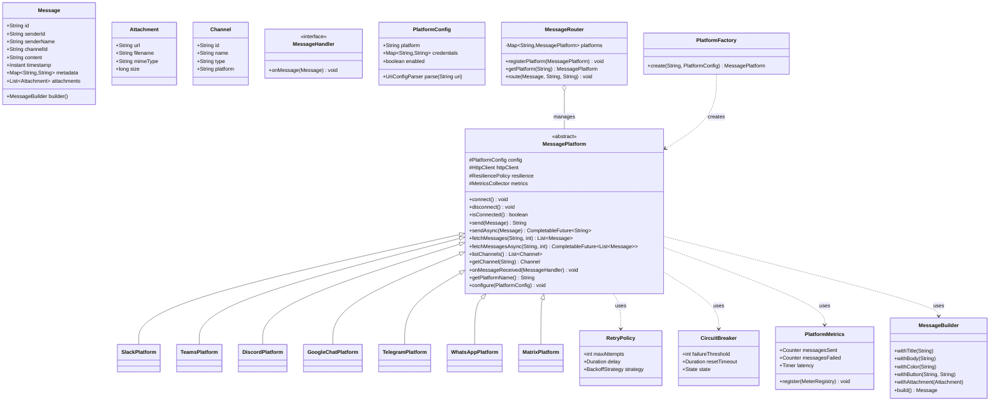

# Message Platform — Design Document (v2.0)

## Overview

`message-platform` is a lightweight, production-ready Java library that acts as a **unified intermediate layer** between a client application and multiple messaging systems (Slack, MS Teams, Discord, Google Chat, Telegram, WhatsApp, Matrix/Zulip/Mattermost, etc.). It abstracts platform-specific APIs behind a single, consistent interface while enforcing resilience, observability, and modern async patterns.

### Design Principles

- **Zero Heavy Dependencies** — No Spring, no Quarkus, no external HTTP clients or JSON parsers. Uses native `java.net.http.HttpClient` (Java 11+) with built-in connection pooling and GZIP support.
- **URI-Based Configuration** — All platforms are configured via standardized URI strings (`slack://bot-token/channel-id`, `discord://webhook-id/webhook-token`, etc.), enabling trivial externalization via environment variables or config servers.
- **Resilience-First** — Built-in rate-limit handling (HTTP 429), exponential backoff, and circuit breakers prevent cascading failures and thread exhaustion.
- **Async & Reactive Native** — Synchronous API by default, but fully supports `CompletableFuture` and optional Project Reactor/RxJava wrappers for non-blocking architectures.
- **Observability Out-of-the-Box** — Native Micrometer integration exposes metrics (`messages.sent`, `messages.failed`, `latency.ms`) without boilerplate.
- **Rich Message Abstraction** — Unified builder pattern automatically translates Markdown, cards, embeds, and attachments into native payloads (Block Kit, Adaptive Cards, etc.).

---

## Package Structure

```
com.messageplatform
├── core/                  # Core abstractions & models
│   ├── Message.java
│   ├── Attachment.java
│   ├── Channel.java
│   ├── MessagePlatform.java       (abstract parent class)
│   ├── MessageHandler.java        (callback interface)
│   └── PlatformConfig.java
├── config/                # URI parsing & configuration
│   ├── UriConfigParser.java
│   └── PlatformCredentials.java
├── resilience/            # Delivery guarantees
│   ├── RetryPolicy.java
│   ├── CircuitBreaker.java
│   └── RateLimiter.java
├── observability/         # Metrics & tracing
│   ├── PlatformMetrics.java
│   └── MicrometerBridge.java
├── formatting/            # Rich payload translation
│   ├── MessageBuilder.java
│   ├── MarkdownTranslator.java
│   └── CardRenderer.java
├── platforms/             # Concrete platform adapters
│   ├── slack/
│   │   └── SlackPlatform.java
│   ├── teams/
│   │   └── TeamsPlatform.java
│   ├── discord/
│   │   └── DiscordPlatform.java
│   ├── googlechat/
│   │   └── GoogleChatPlatform.java
│   ├── telegram/
│   │   └── TelegramPlatform.java
│   ├── whatsapp/
│   │   └── WhatsAppPlatform.java
│   └── matrix/
│       └── MatrixPlatform.java
└── service/               # Orchestration / routing
    ├── MessageRouter.java
    └── PlatformFactory.java
```

---

## Class Diagram (Updated)



---

## Core Classes — Detailed Design

### 1. `Message` & `MessageBuilder` (core / formatting)

The unified message model now includes a fluent builder to handle platform-specific rich formatting automatically.

**Fields:** Same as v1 (`id`, `senderId`, `content`, etc.) + `formatType` (TEXT, MARKDOWN, CARD, EMBED).

**Methods:**
- `static MessageBuilder of(String channelId)` — starts builder chain
- `withTitle(String)`, `withBody(String)`, `withColor(String)` — for card/embed payloads
- `withButton(String label, String url)` — adds action buttons (renders as Block Kit/Adaptive Cards automatically)
- `withAttachment(Attachment)` — handles multipart uploads
- `build()` — returns immutable `Message` ready for transport

**Markdown Translation:** `MarkdownTranslator` normalizes input to platform-native syntax (e.g., Discord `**bold**` → Slack `*bold*`, Teams `<b>bold</b>`).

---

### 2. `PlatformConfig` & URI Parsing (core / config)

Replaces the raw `Map` with structured parsing and validation.

```java
public class PlatformConfig {
    private final String platform;
    private final Map<String, String> credentials = new HashMap<>();
    private boolean enabled = true;
    
    // URI syntax: platform://credential1/credential2?optional_param=value
    public static PlatformConfig fromUri(String uri) { ... }
}
```

Supported URIs:
- `slack://xoxb-bot-token/C012AB3CD`
- `discord://webhook-id/webhook-token`
- `teams://tenant-id/client-id/client-secret`
- `telegram://bot-token/chat-id`
- `whatsapp://twilio-sid/auth-token/phone-number`

---

### 3. `MessagePlatform` (core) — **Abstract Parent Class**

Updated to enforce resilience, async support, and observability.

```java
public abstract class MessagePlatform {

    protected PlatformConfig config;
    protected final HttpClient httpClient; // java.net.http.HttpClient with pooling
    protected final RetryPolicy retryPolicy;
    protected final CircuitBreaker circuitBreaker;
    protected final PlatformMetrics metrics;

    // ─── Lifecycle ───────────────────────────────────────────────
    public abstract void connect() throws PlatformException;
    public abstract void disconnect();
    public abstract boolean isConnected();

    // ─── Sending (Sync & Async) ──────────────────────────────────
    public abstract String send(Message message) throws PlatformException;
    
    public CompletableFuture<String> sendAsync(Message message) {
        return CompletableFuture.supplyAsync(() -> send(message))
                .exceptionally(ex -> throw new CompletionException(resilience.wrap(ex)));
    }

    // ─── Receiving / Fetching ────────────────────────────────────
    public abstract List<Message> fetchMessages(String channelId, int limit) throws PlatformException;
    public CompletableFuture<List<Message>> fetchMessagesAsync(String channelId, int limit) { ... }

    // ─── Channel Management ──────────────────────────────────────
    public abstract List<Channel> listChannels() throws PlatformException;
    public abstract Channel getChannel(String channelId) throws PlatformException;

    // ─── Event Handling ──────────────────────────────────────────
    public abstract void onMessageReceived(MessageHandler handler);

    // ─── Configuration & Resilience ──────────────────────────────
    public void configure(PlatformConfig config) { this.config = config; }
    public void setRetryPolicy(RetryPolicy policy) { this.retryPolicy = policy; }
    public void setCircuitBreaker(CircuitBreaker cb) { this.circuitBreaker = cb; }
    
    // ─── Observability ───────────────────────────────────────────
    public void registerMetrics(MeterRegistry registry) { metrics.register(registry); }
    public abstract String getPlatformName();
}
```

**Design notes:**
- `connect()` initializes the native `HttpClient` with connection pooling, timeout settings, and platform-specific auth headers.
- All network calls route through a resilience wrapper that handles HTTP 429 (reads `Retry-After`), exponential backoff for 5xx, and circuit breaking on consecutive failures.
- Metrics are automatically incremented per call using Micrometer.

---

### 4. `MessageHandler` (core) — Interface

Unchanged. Simple callback for push-based delivery.

```java
@FunctionalInterface
public interface MessageHandler {
    void onMessage(Message message);
}
```

---

## Resilience & Delivery Guarantees

To prevent production outages caused by third-party API instability:

1. **Rate Limit Handling** — Automatically parses `Retry-After` headers. If exceeded, queues the request or applies dynamic delay based on platform limits.
2. **Exponential Backoff** — Configurable base delay and multiplier (default: 500ms, max 30s). Jitter applied to prevent thundering herd.
3. **Circuit Breakers** — Per-platform state machine (`CLOSED` → `OPEN` → `HALF_OPEN`). Prevents thread blocking when a platform is down. Fallback strategies can be injected.
4. **Connection Pooling** — Native `HttpClient` manages HTTP/2 connections, reducing TLS handshake overhead significantly.

---

## Async & Reactive Support

- **Default:** `CompletableFuture<T>` for fire-and-forget or chaining in standard Java apps.
- **Optional Reactor/RxJava Wrappers:** Provided in a separate module (`message-platform-reactive`) exposing `Mono<MessageResponse>` and `Flux<MessageEvent>` for Spring WebFlux, Quarkus, or custom reactive stacks.
- **Thread Safety:** All platform instances are thread-safe. Handlers can be registered per-platform without synchronization overhead.

---

## Observability & Tracing

- **Metrics:** Native Micrometer integration exposes:
  - `messages.sent{platform="slack"}`
  - `messages.failed{platform="discord",reason="rate_limit"}`
  - `message.latency.ms{platform="teams"}`
- **Distributed Tracing:** Automatic propagation of `TraceContext` (OpenTelemetry compatible) via HTTP headers.
- **Logging:** Structured logging with MDC context (`platform`, `channelId`, `msgId`) for easy log aggregation.

---

## Platform Adapters

Each adapter extends `MessagePlatform` and handles platform-specific HTTP/WebSocket calls, auth flows, and payload translation.

| Platform | API / Protocol | Credentials | Push Mechanism | Formatting Target |
|----------|----------------|-------------|----------------|-------------------|
| **Slack** | Web API + Events API | `bot_token`, `workspace_id` | Socket Mode / Webhook | Block Kit |
| **MS Teams** | Microsoft Graph / Bot Framework | `client_id`, `client_secret`, `tenant_id` | Bot Framework Webhook | Adaptive Cards |
| **Discord** | REST + Gateway | `bot_token`, `guild_id` | Gateway WebSocket | Markdown + Embeds |
| **Google Chat** | Chat API | `api_key` / OAuth2 | Webhook / App Script | Markdown + Cards |
| **Telegram** | Bot API | `bot_token`, `chat_id` | Long Polling / Webhook | MarkdownV2 / HTML |
| **WhatsApp** | Cloud API / Twilio | `phone_number_id`, `access_token` | Webhook | Template Messages / Media |
| **Matrix/Zulip/Mattermost** | REST + WS | `server_url`, `user_id`, `token` | Server-Sent Events / WebSocket | Markdown / HTML |

---

## Service Layer

### `MessageRouter`

Unchanged in concept, but now supports async routing and resilience fallbacks.

```java
public class MessageRouter {
    private final Map<String, MessagePlatform> platforms = new ConcurrentHashMap<>();

    public void registerPlatform(MessagePlatform platform) { ... }
    public MessagePlatform getPlatform(String name) { ... }
    
    public CompletableFuture<Void> route(Message message, String targetPlatform, String targetChannel) {
        return getPlatform(targetPlatform).sendAsync(message)
                .thenAccept(msgId -> log.info("Routed to {}", msgId))
                .exceptionally(ex -> { /* fallback or alert */ null; });
    }
}
```

### `PlatformFactory`

Updated to support URI parsing and platform expansion.

```java
public class PlatformFactory {
    public MessagePlatform create(String platformName, PlatformConfig config) {
        return switch (platformName.toLowerCase()) {
            case "slack"   -> new SlackPlatform(config);
            case "teams"   -> new TeamsPlatform(config);
            case "discord" -> new DiscordPlatform(config);
            case "googlechat" -> new GoogleChatPlatform(config);
            case "telegram" -> new TelegramPlatform(config);
            case "whatsapp" -> new WhatsAppPlatform(config);
            case "matrix"  -> new MatrixPlatform(config);
            default -> throw new IllegalArgumentException("Unknown platform: " + platformName);
        };
    }
}
```

---

## Usage Example (Updated)

```java
// 1. URI-based configuration & factory
PlatformConfig slackConfig = PlatformConfig.fromUri("slack://xoxb-xxx/C012AB3CD");
MessagePlatform slack = PlatformFactory.create("slack", slackConfig);
slack.connect();

// 2. Resilience & Observability setup
slack.setRetryPolicy(RetryPolicy.exponentialBackoff(3, Duration.ofMillis(500)));
slack.registerMetrics(new MeterRegistry()); // Micrometer

// 3. Async send with builder
Message msg = MessageBuilder.of("#general")
    .withTitle("Deployment Alert")
    .withBody("✅ Service `auth-api` deployed successfully.")
    .withColor("green")
    .withButton("View Logs", "https://logs.internal/auth-api/123")
    .build();

CompletableFuture<String> future = slack.sendAsync(msg);
future.thenAccept(id -> System.out.println("Sent: " + id))
      .exceptionally(ex -> { System.err.println("Failed: " + ex.getMessage()); return null; });

// 4. Multi-platform routing
MessageRouter router = new MessageRouter();
router.registerPlatform(slack);
router.route(msg, "slack", "#general");
```

---

## Future Extensions (out of scope for v1)

- **Message editing / deletion** — `editMessage(String msgId, String newContent)`, `deleteMessage(String msgId)`
- **Reactions / emojis** — `addReaction(String msgId, String emoji)`
- **Scheduled/Delayed Messages** — Internal delay queue with platform-aware scheduling
- **Multi-threaded Event Processing** — Configurable thread pool for `onMessageReceived` handlers
- **Platform-specific Rich Components** — Sliders, date pickers, multi-select dropdowns (where supported)
